# Dainik Samachar — neatHack 2026 submission

**An AI agent that reads the news for you.** Dainik Samachar plans the searches, scrapes and cleans the
sources, ranks headlines by impact and writes cited briefings and stock research for Indian investors.
Every story keeps its sources attached.

| | |
|---|---|
| Demo video | [youtu.be/aiGtUomSRCU](https://youtu.be/aiGtUomSRCU) |
| Code | [github.com/learner-enthusiast/dainikSamachar](https://github.com/learner-enthusiast/dainikSamachar) |
| Commits on Entire | [entire.io/gh/learner-enthusiast/dainikSamachar](https://entire.io/gh/learner-enthusiast/dainikSamachar/commit/99293e01b128bb70db3439d496d22f72e297abad) (one example; every checkpointed commit has its own page) |
| cfo.ai model | [Shared report](https://cfo.ai/s/Ida4SXIoVpU40HP7) · [workspace page](https://app.cfo.ai/digitale-india-7c43edf1/pages/f4dc1616-0348-4de6-8cc8-86f5728b7684) (needs a cfo.ai login) |
| API docs | `/docs/api` on the live app ([route source](app/docs/api)) |
| Judges page | `/judges` on the live app ([source](app/judges/page.tsx)) |

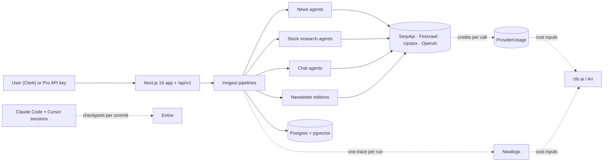

**Contents:** [cfo.ai](#1-cfoai--how-it-shaped-the-business-plan) ·
[Entire](#2-entire--evidence-of-how-it-was-built) ·
[Neatlogs](#3-neatlogs--what-i-traced-debugged-and-improved) ·
[Form answers](#form-answers-copy-paste)

---

## 1. cfo.ai — how it shaped the business plan

### What I asked Ari, and why

Every Dainik Samachar request fans out into paid calls: SerpApi searches, Firecrawl scrapes, Upstox market
data and several LLM calls. If one request costs more than the user pays, growth only makes the loss bigger,
so the cost of an agent run is the main business risk.

I asked Ari to act as the CFO. The brief was to:
1. inspect the GitHub repo,
2. verify the provider prices,
3. build unit economics per pipeline: briefing, news research, stock report, chat and API request,
4. model three scenarios,
5. run sensitivity tests,
6. propose pricing tiers with break-even at 60%, 70% and 80% margin targets,
7. list the top financial risks,
8. recommend what to instrument.

### What Ari built

Ari produced a seven-page model: Assumptions, Evidence, Unit economics, Operating forecast, Sensitivity,
Pricing and Risks. It ran for **36m 27s** and exported `Financial model (6 pages).xlsx`, which is 331 KB.
Ari's step log shows it reconciling tier prices, checking the sensitivity cases, and checking risk notes and
provider-source coverage ([screenshot 3](docs/hackathon/cfo-3.webp)).

On the method, the model is explicit that it is a planning model, not accounting. Token counts are estimates
grounded in the code's stages, not production traces. Costs are at nominal provider prices, not
invoice-derived actuals.

### Key findings

| Metric | Value | Label at source | Source |
|---|---|---|---|
| Cost per clean run, news briefing | **$0.20** | estimated | [Unit economics](docs/hackathon/cfo-1.webp) |
| Cost per clean run, API research job | $0.14 | estimated | [Unit economics](docs/hackathon/cfo-1.webp) |
| Cost per clean run, conversation session | $0.11 | estimated | [Unit economics](docs/hackathon/cfo-1.webp) |
| Cost per clean run, stock report | $0.08 | estimated | [Unit economics](docs/hackathon/cfo-1.webp) |
| Cost per clean run, news research | $0.04 | estimated | [Unit economics](docs/hackathon/cfo-1.webp) |
| Searches per clean news briefing | 12 (stock report: 6) | estimated | [Unit economics](docs/hackathon/cfo-1.webp) |
| LLM calls per clean run | briefing 20 · chat 25 · stock report 4 | estimated | [Unit economics](docs/hackathon/cfo-1.webp) |
| Attempted runs per month | 8,030 (Oct-26) → 9,868.99 (May-27) | forecast | [Operating forecast](docs/hackathon/cfo-2.webp) |
| Pro subscription | ₹199 / month | assumed (matches [`services/billing/pricing.ts`](services/billing/pricing.ts)) | [Assumptions](docs/hackathon/cfo-3.webp) |
| API price | ₹20 / job | assumed | [Assumptions](docs/hackathon/cfo-3.webp) |
| Paid conversion · MAU growth | 8% · 3% / month | assumed | [Assumptions](docs/hackathon/cfo-3.webp) |
| Target margin | 0.7 | assumed | [Assumptions](docs/hackathon/cfo-3.webp) |

**The headline finding is that a news briefing is the most expensive run: an estimated $0.20, which is 2.5× a
stock research report ($0.08).** Search drives the cost. Of the briefing's $0.20, $0.12 is search, from
12 searches per clean run.

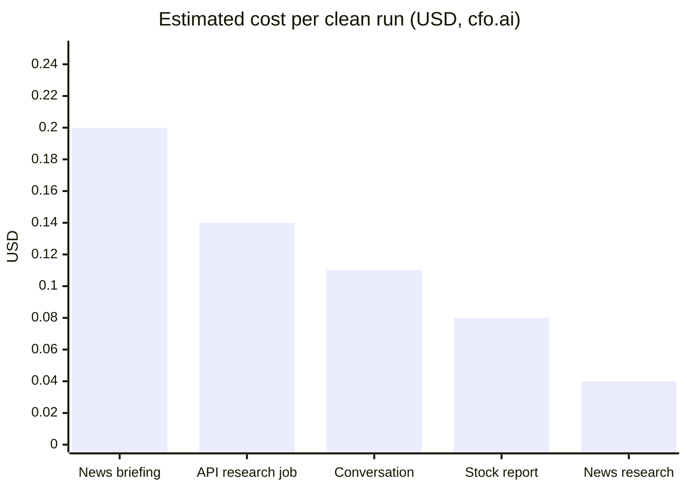

| Pipeline | Clean-run cost (USD) | of which search | Expected AI cost per attempt |
|---|---|---|---|
| News briefing | 0.20 | 0.12 | 0.07 |
| API research job | 0.14 | 0.09 | 0.04 |
| Conversation session | 0.11 | 0.08 | 0.02 |
| Stock report | 0.08 | 0.06 | 0.01 |
| News research | 0.04 | 0.03 | 0.01 |

All of these are cfo.ai estimates.

<p>
  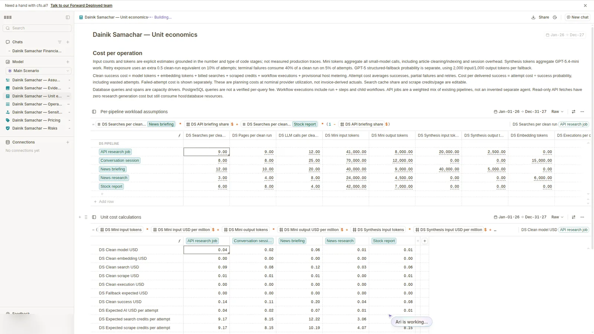
  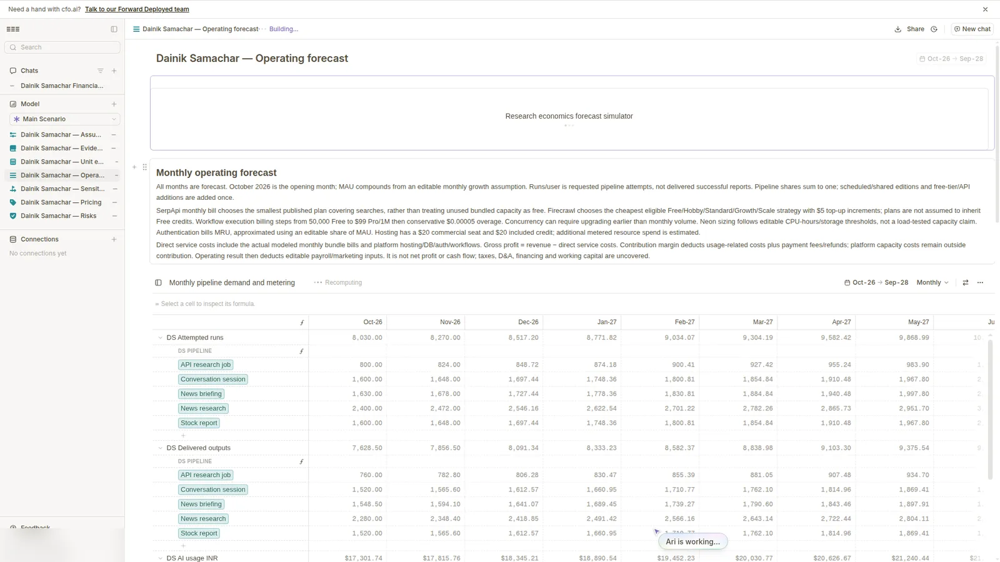
  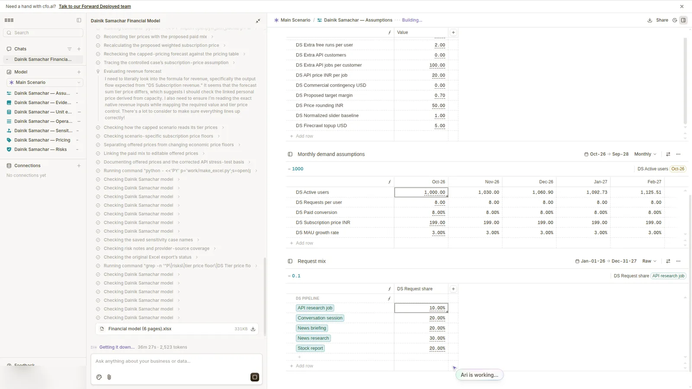
</p>

### Next steps (no pricing or quota change made yet)

No commit in the repo yet shows a change made because of the model. The model takes the existing ₹199 Pro
price and the API's per-plan limits ([`lib/api/v1/limits.ts`](lib/api/v1/limits.ts): 60 requests a minute and
50 pipeline jobs a day, both overridable by env) as inputs. So the honest list is next steps:

- **Optimise briefings first.** Search is 60% of the briefing's estimated cost ($0.12 of $0.20), so caching
  and fewer queries per tier come first.
- **Check the model's LLM estimate against measured traces.** The model estimates $0.01 of AI cost per stock
  report attempt. The two stock research runs I traced locally spent about $0.0435 and about $0.021 on LLM
  calls (see [§3](#cost-visibility)). Feed the measured numbers back into the model.
- **Use real credit data.** Per-user SerpApi and Firecrawl credits are now recorded (see
  [§3](#cost-visibility)). The next model revision can use actual credits per run instead of assumed ones.

---

## 2. Entire — evidence of how it was built

### 2.1 How did you use Entire?

- **Setup:** Entire is enabled on this repo with the Claude Code and Cursor agent hooks, and checkpoints sync
  to `origin` ([`.entire/settings.json`](.entire/settings.json)).
- **Checkpoints on (almost) every commit:** **38 of the repo's 40 commits** carry an `Entire-Checkpoint:`
  trailer, which is 37 unique checkpoints (`ef159a1` and `1601d33` share one). The two without one are the
  initial scaffold commits, `6d0f798` and `57b51dd`.
- **Agents seen in the checkpoints:** Claude Code and Cursor. The models recorded were `claude-opus-5-5`,
  `composer-2.5-fast` and `grok-4.7-high-fast`.
- **Six tailored trail runners**, committed in
  [`5a340c5`](https://github.com/learner-enthusiast/dainikSamachar/commit/5a340c5afb3909ad0d3c6700a34df27fa4fc9ede)
  under [`.entire/runners/`](.entire/runners). Each prompt names this app's stack and risky areas: briefings,
  research chat, chat→story, Razorpay Pro and Upstox.

| Runner | Kind | Output | Polarity / model |
|---|---|---|---|
| [`trail-review`](.entire/runners/trail-review.json) | Code review comments (bugs, regressions, security, data loss only) | review comments | Sonnet, on push |
| [`trail-risk`](.entire/runners/trail-risk.json) | Risk score 0–100 | percent | lower is better |
| [`trail-drift`](.entire/runners/trail-drift.json) | Drift from the branch's intent, 0–100 | percent | lower is better |
| [`trail-security`](.entire/runners/trail-security.json) | Adversarial security score, 0–100 | percent | lower is better |
| [`trail-confidence`](.entire/runners/trail-confidence.json) | Confidence score, 0–100 | percent | higher is better |
| [`trail-summary`](.entire/runners/trail-summary.json) | Problem → solution summary | markdown | Haiku |

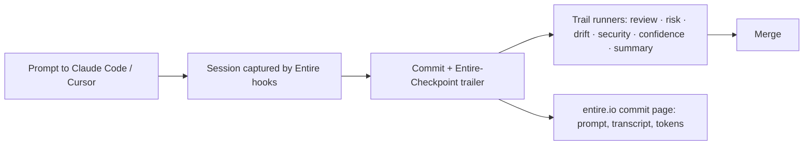

### 2.2 Evidence links

| Decision / feature | Commit | Entire checkpoint | Agent · model |
|---|---|---|---|
| Neatlogs SDK added | [`712fad5`](https://github.com/learner-enthusiast/dainikSamachar/commit/712fad5ec21f28261ee9c59a4dbe60d8f5d63261) | [01M4JK1960…](https://entire.io/gh/learner-enthusiast/dainikSamachar/commit/712fad5ec21f28261ee9c59a4dbe60d8f5d63261) | Claude Code · recorded as `grok-4.7-high-fast` |
| Trail runners and asset types | [`5a340c5`](https://github.com/learner-enthusiast/dainikSamachar/commit/5a340c5afb3909ad0d3c6700a34df27fa4fc9ede) | [01M4MM4A48…](https://entire.io/gh/learner-enthusiast/dainikSamachar/commit/5a340c5afb3909ad0d3c6700a34df27fa4fc9ede) | Cursor · `claude-opus-5-5` |
| Stock research traced end to end | [`d542c4f`](https://github.com/learner-enthusiast/dainikSamachar/commit/d542c4f38f8dff300d20b045985f23a256d0acd5) | [01M4MVX2P4…](https://entire.io/gh/learner-enthusiast/dainikSamachar/commit/d542c4f38f8dff300d20b045985f23a256d0acd5) | Claude Code · `claude-opus-5-5` |
| Tracing centralised, every workflow | [`f9c5d3a`](https://github.com/learner-enthusiast/dainikSamachar/commit/f9c5d3a142f333d9548022408b0b6967e88e9065) | [01M4N0TSEQ…](https://entire.io/gh/learner-enthusiast/dainikSamachar/commit/f9c5d3a142f333d9548022408b0b6967e88e9065) | Claude Code · `claude-opus-5-5` |
| Newsletter edit, pause and delete lifecycle | [`64a0f0b`](https://github.com/learner-enthusiast/dainikSamachar/commit/64a0f0bed2f43ffb30261c4e5ac71f6e824f8e98) | [01M4N5AHN9…](https://entire.io/gh/learner-enthusiast/dainikSamachar/commit/64a0f0bed2f43ffb30261c4e5ac71f6e824f8e98) | Claude Code · `claude-opus-5-5` |
| Pro-only API keys | [`35f9637`](https://github.com/learner-enthusiast/dainikSamachar/commit/35f9637e915190ddacb78ceafcf7a60c4e85d469) | [01M4QC3W04…](https://entire.io/gh/learner-enthusiast/dainikSamachar/commit/35f9637e915190ddacb78ceafcf7a60c4e85d469) | Cursor · `claude-opus-5-5` |
| SerpApi and Firecrawl credit rules | [`98e01ff`](https://github.com/learner-enthusiast/dainikSamachar/commit/98e01ff71f8fbed588a221dc14b245f062be633b) | [01M4QCW0TV…](https://entire.io/gh/learner-enthusiast/dainikSamachar/commit/98e01ff71f8fbed588a221dc14b245f062be633b) | Claude Code · `claude-opus-5-5` |
| Usage reporting and reconcile cron | [`31a4e2f`](https://github.com/learner-enthusiast/dainikSamachar/commit/31a4e2f1d9daf98c71220ec400fc425d0a98f746) | [01M4QE38Z8…](https://entire.io/gh/learner-enthusiast/dainikSamachar/commit/31a4e2f1d9daf98c71220ec400fc425d0a98f746) | Claude Code · `claude-opus-5-5` |
| Public API v1 handler | [`30f6a51`](https://github.com/learner-enthusiast/dainikSamachar/commit/30f6a51b74f8fde197a8ef78dc11c5872499a9d2) | [01M4QE4HYK…](https://entire.io/gh/learner-enthusiast/dainikSamachar/commit/30f6a51b74f8fde197a8ef78dc11c5872499a9d2) | Claude Code · `claude-opus-5-5` |
| Async jobs and signed webhooks | [`99293e0`](https://github.com/learner-enthusiast/dainikSamachar/commit/99293e01b128bb70db3439d496d22f72e297abad) | [01M4QEGZD1…](https://entire.io/gh/learner-enthusiast/dainikSamachar/commit/99293e01b128bb70db3439d496d22f72e297abad) | Claude Code · `claude-opus-5-5` |
| OpenAPI 3.1 and `/docs/api` | [`d5862fa`](https://github.com/learner-enthusiast/dainikSamachar/commit/d5862fa46502252c33cd3b7ff0f711d0ebc25ff8) | [01M4QESDF9…](https://entire.io/gh/learner-enthusiast/dainikSamachar/commit/d5862fa46502252c33cd3b7ff0f711d0ebc25ff8) | Claude Code · `claude-opus-5-5` |
| API tests: unit, integration, contract | [`8faec6c`](https://github.com/learner-enthusiast/dainikSamachar/commit/8faec6caddf049b9f4606124589168b35d69aa4b) | [01M4QF837T…](https://entire.io/gh/learner-enthusiast/dainikSamachar/commit/8faec6caddf049b9f4606124589168b35d69aa4b) | Claude Code · `claude-opus-5-5` |

### 2.3 Checkpoints: progress and key decisions

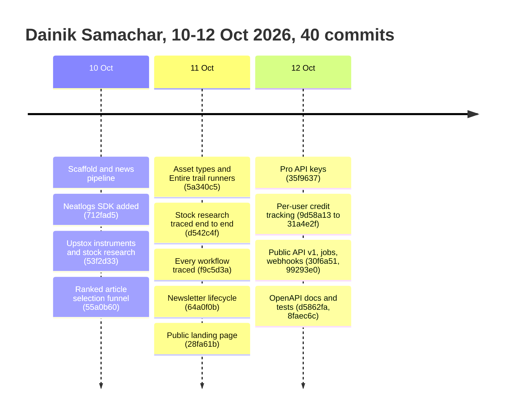

The decision cards below quote the prompts stored on each checkpoint (read with `entire checkpoint explain
<id> --transcript`) and the commit bodies.

**① One trace per user action, across Inngest steps** ·
[`d542c4f`](https://entire.io/gh/learner-enthusiast/dainikSamachar/commit/d542c4f38f8dff300d20b045985f23a256d0acd5)
- *Prompt (my answers to the agent):* "Pass the Clerk id through the event from the API route as endUserId;
  also put the internal users.id in metadata. Cron/newsletter runs use "system". Use
  inject/extractTraceContext for one trace per Inngest run; if the dashboard doesn't show it cleanly, fall
  back to runId linking."
- *What changed:* the API route opens the root span. The run context (runId, W3C traceparent, Clerk end user,
  internal userId) travels in the Inngest event, and every step rejoins it. Inputs and outputs are redacted
  and clipped to about 4 KB.
- *Why:* a stock research run spans several Inngest requests. Without propagation, one user action would show
  up as many unrelated traces.

**② Centralise tracing instead of wrapping each call site** ·
[`f9c5d3a`](https://entire.io/gh/learner-enthusiast/dainikSamachar/commit/f9c5d3a142f333d9548022408b0b6967e88e9065)
- *What changed:* one module, [`lib/observability/neatlogs.ts`](lib/observability/neatlogs.ts), provides
  `runWorkflow`, `continueWorkflow`, `agent`, `tool` and `traceCarrier`. An Inngest middleware rejoins the
  trace for every `step.run`, so pipeline code didn't change.
- *Decision recorded in the session:* SDK 1.1.28's `span()` ignores tags and metadata, so tags go on root and
  step spans. Upstox is wrapped at the API registry rather than the transport, so tool spans get real names
  and arguments, for example `upstox.getKeyRatios`.

**③ Bill-accurate credit rules, not call counts** ·
[`98e01ff`](https://entire.io/gh/learner-enthusiast/dainikSamachar/commit/98e01ff71f8fbed588a221dc14b245f062be633b)
- *Prompt (approved rules):* "SerpApi cache rule (created_at > 2s before request start → 0, reason
  "cached"): approved. 200 response with an "error" field → 1, billable; HTTP error → 0; client-side
  timeout/abort → 1, reason "timeout_assumed". Firecrawl: always use metadata.creditsUsed."
- *Why:* each rule matches how the provider actually bills, which was verified live before the rules were
  written. Without that, per-user cost would be wrong.

**④ Report drift, don't alert, while dev and prod share keys** ·
[`31a4e2f`](https://entire.io/gh/learner-enthusiast/dainikSamachar/commit/31a4e2f1d9daf98c71220ec400fc425d0a98f746)
- *Prompt:* "Keys: shared between dev and prod for now. Make the reconcile cron report drift without alerting
  (note that provider totals include other environments). Alerting should be a one-line config change (env
  flag USAGE_RECONCILE_ALERTS=true)."
- *What changed:* a daily 06:00 IST cron
  ([`inngest/providerUsageReconcile.ts`](inngest/providerUsageReconcile.ts)) compares recorded credits with
  the provider dashboards and stores the drift.

**⑤ Briefing dedupe in the API layer, not in the pipeline** ·
[`30f6a51`](https://entire.io/gh/learner-enthusiast/dainikSamachar/commit/30f6a51b74f8fde197a8ef78dc11c5872499a9d2)
- *Prompt:* "Briefing dedupe: don't change requestNews. In the API layer: existing briefing for same
  user/date/scope with ALL params equal → 200 with the existing job, "deduplicated": true, no quota charged."
- *Why:* a duplicate API call shouldn't buy a second $0.20 briefing (see [§1](#key-findings)), and the web
  pipeline stays untouched.

<p>
  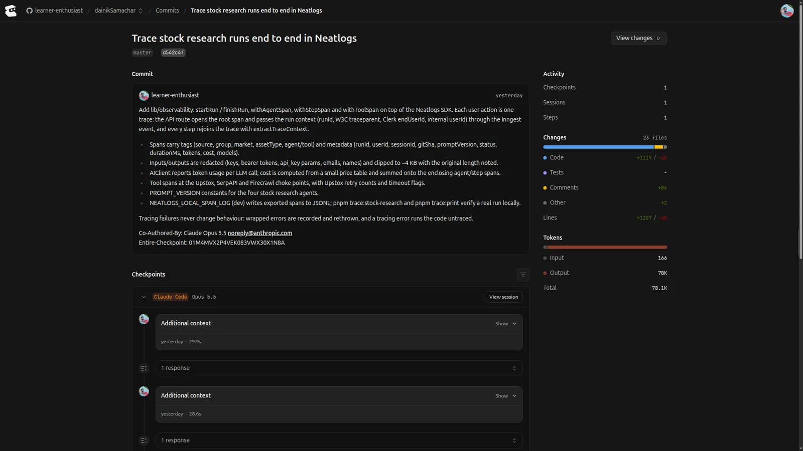
  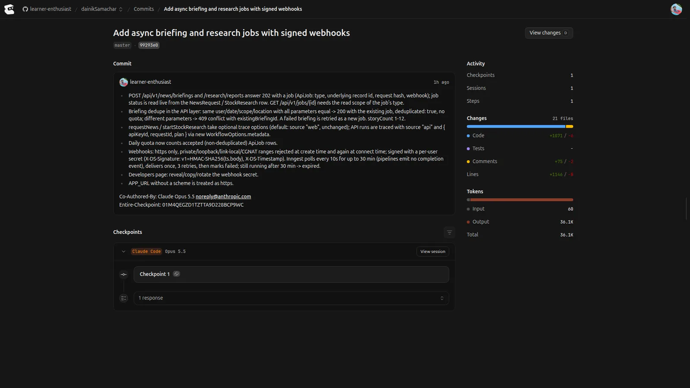
</p>

### 2.4 entire-graph: finding code or assessing risky changes

I didn't use entire-graph during the hackathon. To find code and assess changes I used checkpoints,
`entire checkpoint explain` and the trail runners in §2.5.

### 2.5 Runner verdicts

The six runners are configured and tailored to this app (§2.1). No verdicts have been captured yet.

### 2.6 Open-source builds and integrations

Only things that exist in this repo:
- **Six project-specific Entire trail runners** ([`.entire/runners/`](.entire/runners)), reusable as a
  template for any Next.js + Inngest app.
- **A commit → Entire link generator**, [`scripts/judgesCommits.ts`](scripts/judgesCommits.ts)
  (`pnpm judges:commits`). It reads each commit's `Entire-Checkpoint` trailer and builds
  `entire.io/gh/<owner>/<repo>/commit/<sha>` links for the public [`/judges`](app/judges/page.tsx) page.
- **Neatlogs + Inngest integration:** an Inngest middleware that rejoins a W3C trace in every step
  ([`lib/observability/inngestMiddleware.ts`](lib/observability/inngestMiddleware.ts)).
- **A Pro public REST API with an OpenAPI 3.1 contract**, checked in CI by `pnpm api:check`
  ([`scripts/checkOpenApi.ts`](scripts/checkOpenApi.ts)).
- **External agents:** Claude Code and Cursor, both hooked into Entire.

---

## 3. Neatlogs — what I traced, debugged and improved

### Tracing

**Every user action is one Neatlogs trace.** The API route opens the root span with the workflow name and the
user's Clerk id as end user. The trace context rides the Inngest event, and an Inngest middleware rejoins it
in every step. Follow-up jobs stay in the parent trace, for example the chat's topic and embedding jobs.

| Recorded | Where |
|---|---|
| Workflow name (`neatlogs.workflow.name`), end user (Clerk id, or `system` for cron) | root span — [`neatlogs.ts`](lib/observability/neatlogs.ts) |
| Tags: source, group, market, assetType, agent/tool, provider | root and step spans |
| Metadata: runId, userId, sessionId, gitSha, promptVersion, status, durationMs, tokens, cost | root and step spans |
| Agent spans (28 agent exports, one line each: `agent("area.name", fn)`) | [`Agents/`](Agents) |
| Tool spans at the SerpApi, Upstox registry, Firecrawl, feed and Resend choke points | [`neatlogs.ts`](lib/observability/neatlogs.ts) |
| LLM spans with token usage (`wrapOpenAI`); cost from a local price table | [`clients/neatlogsClient.ts`](clients/neatlogsClient.ts), [`llmUsage.ts`](lib/observability/llmUsage.ts) |
| Redaction: api_key params, bearer tokens, secret JSON fields, emails; clip to ~4 KB | [`mask.ts`](lib/observability/mask.ts) |

**Workflows wired:** Stock research, Chat, News, News rerun, Newsletter and Embeddings
([`f9c5d3a`](https://github.com/learner-enthusiast/dainikSamachar/commit/f9c5d3a142f333d9548022408b0b6967e88e9065)).
Stock research, Chat, News and Embeddings were verified with real runs. News rerun, Newsletter and the
`onFailure` path are wired the same way but weren't exercised in a real run at commit time.

**One real run's span tree.** This is trace `7328f2a1b1e1ed754d63631f74e4b910`: a Reliance stock research run
with the question "latest quarterly results and main risks", 36 spans, about 42 s. The numbers come from the
local span log (`pnpm trace:print`), recorded in checkpoint
[01M4MVX2P4…](https://entire.io/gh/learner-enthusiast/dainikSamachar/commit/d542c4f38f8dff300d20b045985f23a256d0acd5):

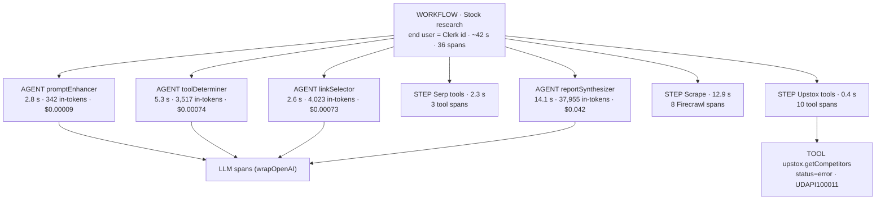

After the refactor, real runs produced one trace each
([`f9c5d3a`](https://entire.io/gh/learner-enthusiast/dainikSamachar/commit/f9c5d3a142f333d9548022408b0b6967e88e9065)):

| Run | Trace id | Spans | Result |
|---|---|---|---|
| Stock research (HDFCBANK) | `fc21343f6a714b883170854ed6a0871b` | 43 | Completed in about 48 s |
| Chat ("What moved Indian bank stocks this week…") | `34d118794690a8ea4d9e0a7ff0c8abf7` | 71 | Replied |
| News (world, 3 stories) | `9869a71c4d509bcf46102526ec7703ce` | 80 | Success |
| Embeddings (standalone) | `0992e730a263fe074de135cc2ea40582` | 8 | Done |

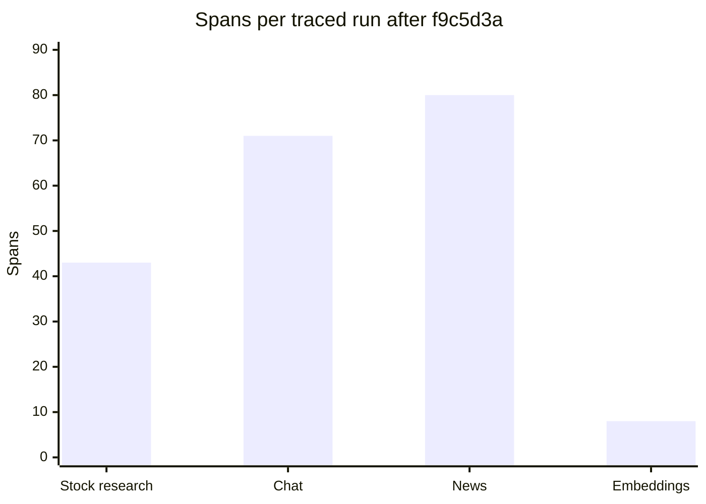

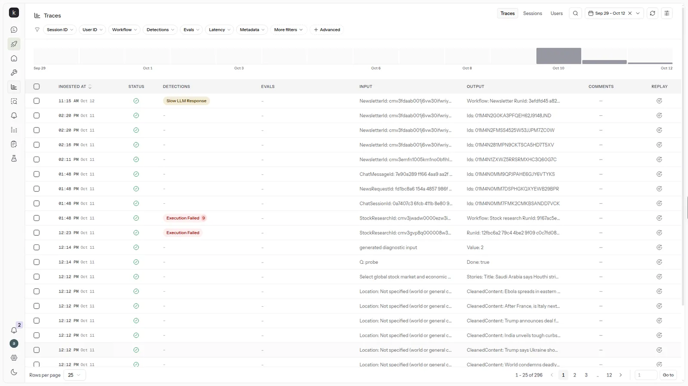

*The neatlogs project: 296 traces between Sep 29 and Oct 12.*

### The reliability loop

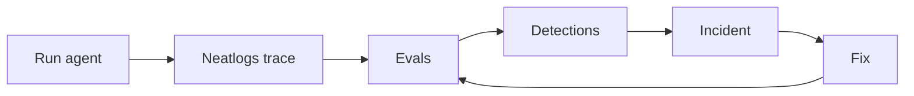

How much of this loop exists today:
- **Run → trace: built.**
- **Trace → detections: partly.** The neatlogs dashboard flags runs (screenshot above). I haven't created
  any rules of my own yet; the ones below are drafted from measured runs.
- **Evals: not built.** No eval dataset, scorers or reports are in the repo yet.

### Detections

**Raised by the neatlogs dashboard** (screenshot above). I didn't configure these:
- **Slow LLM Response:** flagged on a newsletter trace on 12 Oct.
- **Execution Failed:** flagged on two stock research traces on 11 Oct. One shows the badge 9 times (output
  `Workflow: Stock research RunId: 9167ac5e…`). The other's output starts `RunId: 12fbc6a2…`, the run that hit
  the `getCompetitors` error below.

**Proposed rules, not yet created in the dashboard.** They were drafted from measured runs, in checkpoint
[01M4N0TSEQ…](https://entire.io/gh/learner-enthusiast/dainikSamachar/commit/f9c5d3a142f333d9548022408b0b6967e88e9065).
The thresholds come from the traced runs: the synthesizer used 12.9k–41k tokens and $0.02–0.042 per call, and
Firecrawl took up to 13 s.

| Detector | What it catches | Neatlogs mechanism |
|---|---|---|
| `unsafe_advice` | Promised returns or direct buy calls ("guaranteed", "buy now", "multibagger"…) | Regex on output, report synthesizer and chat agents |
| `upstox_error` | Upstox error codes such as `UDAPI100011` | Regex `UDAPI\d{6}` on TOOL span output |
| `tool_error_payload` | Tool responses reporting failure | Regex on TOOL span output |
| `secret_leak` | Keys or bearer tokens that slipped past the mask | Regex on input and output, all spans |
| `empty_or_refusal` | Agent gave up or refused | Regex on AGENT span output |
| `high_tokens` | `total_tokens > 45000` (largest synthesizer call seen: 41k) | Condition on LLM spans |
| `slow_llm` | `latency_ms > 60000` | Condition on LLM spans |
| `slow_tool` | `latency_ms > 20000` | Condition on TOOL spans |
| `high_cost` | `run.cost_usd > 0.05` (largest step seen: $0.042) | Condition on root/step spans |
| `tool_loop` | `run.llm_calls > 25` | Condition on step spans |
| `pii` | Personal data in spans | Built-in PII detector |

There are no in-code detectors in the repo. Creating these rules in the dashboard is on the list in
[What I'd do next](#what-id-do-next).

### Incidents

**Incident 1: Upstox `getCompetitors` fails on every stock run (OPEN)**
- **Detected by:** the tool span in the first end-to-end trace, `tool.upstox.getCompetitors`, `status=error`.
  It appeared on Reliance (`INE002A01018`, runId `12fbc6a2`) and again on HDFC Bank (`INE040A01034`). The
  neatlogs dashboard shows Execution Failed on the same run.
- **Trace:** `7328f2a1b1e1ed754d63631f74e4b910`; the failing span is shown in the tree above.
- **Root cause:** `UDAPI100011: Invalid Instrument key`. The call passes a bare ISIN
  ([`services/upstox/fundamentals.ts`](services/upstox/fundamentals.ts)). The other fundamentals calls accept
  that, but this endpoint rejects it.
- **Impact:** the agent keeps going. It was the only Upstox tool that failed in both traced runs, so the
  report is written without competitor data.
- **Status: OPEN.** It was detected via tracing, the root cause is the invalid instrument key
  (`UDAPI100011`), and the fix is pending.

**Incident 2: News pipeline step failed with a ZodError on `locationRadiusMeters`**
- **Detected by:** the Inngest dev log, which showed `POST /api/inngest?fnId=my-app-news-pipeline … 500` with
  "expected number, received undefined". This was before tracing covered the news workflow, so it was found
  in the log, not in neatlogs.
- **Fix:**
  [`defa386`](https://github.com/learner-enthusiast/dainikSamachar/commit/defa3867f3cf6f5857ad21135a34a4d697cd36d6)
  added location radius handling to the newsletter → news pipeline invoke.
- **Before → after:** not measured.

### Results

| What | Before | After | Source |
|---|---|---|---|
| Workflows traced end to end | 0 (SDK init and `wrapOpenAI` only, [`712fad5`](https://github.com/learner-enthusiast/dainikSamachar/commit/712fad5ec21f28261ee9c59a4dbe60d8f5d63261)) | 6 wired, 4 verified with real runs | [`f9c5d3a`](https://github.com/learner-enthusiast/dainikSamachar/commit/f9c5d3a142f333d9548022408b0b6967e88e9065) |
| Inngest steps in the run's trace | separate, unlinked | one trace per run (43–80 spans) | trace ids above |
| Secrets in exported spans | not checked | none found (env secrets, bearer tokens, `api_key`, emails) | [`f9c5d3a`](https://github.com/learner-enthusiast/dainikSamachar/commit/f9c5d3a142f333d9548022408b0b6967e88e9065) |
| Eval pass rate (overall and per category) | to be measured | to be measured | eval run |
| Detections per N runs | to be measured | to be measured | neatlogs detections |
| p95 latency, cost per run | to be measured | to be measured | trace root and step spans |

**How the "to be measured" rows will be filled in:**
- **Eval dataset:** a fixed set of queries per pipeline (stock research, chat, news) with checkable
  expectations.
- **Runs:** each query runs live, with its trace id saved next to its score.
- **Baseline:** taken before a fix such as `getCompetitors`, then re-run after it.
- **Detections and latency:** counted from the same traces.

No eval suite exists in the repo yet, so these rows show no numbers.

### Cost visibility

Tracing and credit tracking together give the measured side of the cfo.ai model:

- **LLM cost per run, from traces.** The Reliance stock run's four agents came to about **$0.0435**, with
  $0.042 of that from the report synthesizer. The HDFC Bank run after the refactor summed to about
  **$0.021** across its steps. Both use the local price table (`gpt-5.4-mini` at $0.75 / $4.50 per 1M
  tokens), and those prices come from third-party pages, not an official OpenAI list. You can override them
  with `LLM_PRICES_JSON`.
- **SerpApi and Firecrawl credits per user, per run.** These were built in
  [`9d58a13`](https://github.com/learner-enthusiast/dainikSamachar/commit/9d58a13c99d6a0fba37303f635498ea87d9784d2) →
  [`98e01ff`](https://github.com/learner-enthusiast/dainikSamachar/commit/98e01ff71f8fbed588a221dc14b245f062be633b) →
  [`76f46cf`](https://github.com/learner-enthusiast/dainikSamachar/commit/76f46cf6cd198031317d710ff4b16dc03c041175) →
  [`31a4e2f`](https://github.com/learner-enthusiast/dainikSamachar/commit/31a4e2f1d9daf98c71220ec400fc425d0a98f746).
  - **How it records:** every call writes a `ProviderUsage` row with the user, runId, workflow and credits
    ([`lib/usage/creditRules.ts`](lib/usage/creditRules.ts)). It also logs `provider.usage` on the active
    neatlogs TOOL span, so a trace and its credits share a runId.
  - **Admin view:** [`/admin/usage`](app/admin/usage/page.tsx) shows totals, top users and a per-run
    drill-down.
  - **Reconcile:** a 06:00 IST cron reconciles the recorded credits against SerpApi and Firecrawl.
- **Connection to cfo.ai:** the model's "searches per clean run" (12 for a briefing, 6 for a stock report) is
  an estimate. These rows are the actuals to replace it with.

### What I'd do next

1. **Build the eval loop:** a fixed dataset of queries, scorers and saved baseline vs. after reports with
   trace ids, so improvements have numbers.
2. **Create the drafted detection rules in neatlogs, then fix `getCompetitors`:** use the instrument key
   format the endpoint expects, and show the before → after using the `upstox_error` detection.
3. **Sum cost onto the run's root:** each step's tokens and cost go on its own step span, but the root shows
   $0. Then the cfo.ai model can use measured cost per run and credits instead of estimates.

---

## Built with

Next.js 16 · Prisma + Postgres/pgvector · Inngest · Clerk · OpenAI · SerpApi · Firecrawl · Upstox ·
Resend · Razorpay. **Neatlogs** for tracing, **Entire** for checkpoints and trail runners, **cfo.ai (Ari)**
for the business model.

**Team:** solo, [@learner-enthusiast](https://github.com/learner-enthusiast).

[Demo](https://youtu.be/aiGtUomSRCU) · [GitHub](https://github.com/learner-enthusiast/dainikSamachar) ·
[Entire](https://entire.io/gh/learner-enthusiast/dainikSamachar/commit/99293e01b128bb70db3439d496d22f72e297abad) ·
[cfo.ai report](https://cfo.ai/s/Ida4SXIoVpU40HP7)

---

## Form answers (copy-paste)

### 1. How did cfo.ai shape your business plan?

```text
Every request fans out into paid SerpApi, Firecrawl, Upstox and LLM calls, so run cost is my main business risk. I asked Ari (cfo.ai) to act as CFO: inspect the GitHub repo, verify provider prices, build unit economics per pipeline (briefing, news research, stock report, chat, API request), three scenarios, sensitivity tests, pricing tiers with break-even at 60/70/80% margins, top risks and instrumentation advice. Ari built a 7-page model in 36m 27s. Key finding: a news briefing is my most expensive run at an estimated $0.20 per clean run, 2.5x a stock report ($0.08), and $0.12 of that is search. No price or quota has changed yet; next steps are optimising briefing search first and feeding measured costs back in (my traced stock runs spent $0.021-$0.0435 on LLM calls vs the model's $0.01 estimate). Report: https://cfo.ai/s/Ida4SXIoVpU40HP7
```

### 2. How did you use Entire?

```text
Entire is enabled on the repo with Claude Code and Cursor hooks. 38 of my 40 commits carry an Entire-Checkpoint trailer (37 checkpoints), so each commit links to the prompt and session that produced it. I also committed six trail runners tailored to the app (review, risk, drift, security, confidence, summary) in .entire/runners. Evidence:
- Tracing design: https://entire.io/gh/learner-enthusiast/dainikSamachar/commit/d542c4f38f8dff300d20b045985f23a256d0acd5
- Every workflow traced: https://entire.io/gh/learner-enthusiast/dainikSamachar/commit/f9c5d3a142f333d9548022408b0b6967e88e9065
- Credit rules: https://entire.io/gh/learner-enthusiast/dainikSamachar/commit/98e01ff71f8fbed588a221dc14b245f062be633b
- Async jobs + webhooks: https://entire.io/gh/learner-enthusiast/dainikSamachar/commit/99293e01b128bb70db3439d496d22f72e297abad
```

### 3. Checkpoints: show progress and key decisions

```text
10 Oct: news pipeline, Neatlogs SDK, Upstox stock research. 11 Oct: trail runners, end-to-end tracing, newsletters, landing. 12 Oct: Pro API keys, per-user credit tracking, public API v1, OpenAPI docs and tests. Key decisions, each on its checkpoint:
1) One trace per user action across Inngest steps, Clerk id as end user: https://entire.io/gh/learner-enthusiast/dainikSamachar/commit/d542c4f38f8dff300d20b045985f23a256d0acd5
2) Centralise tracing in one module plus an Inngest middleware: https://entire.io/gh/learner-enthusiast/dainikSamachar/commit/f9c5d3a142f333d9548022408b0b6967e88e9065
3) Credit rules that match provider billing (cache hits free, HTTP errors free): https://entire.io/gh/learner-enthusiast/dainikSamachar/commit/98e01ff71f8fbed588a221dc14b245f062be633b
4) Briefing dedupe in the API layer, no quota charged: https://entire.io/gh/learner-enthusiast/dainikSamachar/commit/30f6a51b74f8fde197a8ef78dc11c5872499a9d2
```

### 4. entire-graph: find code or assess risky changes

```text
I didn't use entire-graph during the hackathon. To find code and assess changes I used:
- Checkpoints on 38 of 40 commits, each linking the prompt and session that produced the commit;
- entire checkpoint explain to read why a change was made (prompts and transcript per checkpoint);
- Six trail runners tailored to this repo (.entire/runners): risk, drift, security and confidence scores, a review runner limited to real bugs, regressions, security or data-loss issues, and a summary. They're configured; no verdicts captured yet.
```

### 5. Open-source builds: working features, integrations, Entire CLI, graph or external agents

```text
- Six project-specific Entire trail runners (.entire/runners), reusable for any Next.js + Inngest app.
- scripts/judgesCommits.ts: reads Entire-Checkpoint trailers from git and generates entire.io commit links for a public /judges page.
- A Neatlogs + Inngest middleware that rejoins one W3C trace in every step (lib/observability/inngestMiddleware.ts).
- A Pro public REST API with an OpenAPI 3.1 contract, checked in CI (pnpm api:check), with async jobs and signed webhooks.
- External agents: Claude Code and Cursor, both hooked into Entire.
Repo: https://github.com/learner-enthusiast/dainikSamachar
```

### 6. Neatlogs: what did you trace, debug or improve?

```text
I traced every workflow (stock research, chat, news, rerun, newsletter, embeddings) as one Neatlogs trace per user action: Clerk end user, workflow name, agent/tool/LLM spans, tokens and cost, with secrets masked. The trace context rides Inngest events, so multi-step runs stay in one trace (43-80 spans in real runs). The first stock research trace exposed a real bug: upstox.getCompetitors fails with UDAPI100011 (Invalid Instrument key) on every stock run. The agent kept going, but its reports lacked competitor data. The bug is open; fix pending. Neatlogs flagged that run as Execution Failed. Traces also showed the report synthesizer dominates cost ($0.042 of ~$0.0435 per run, 38k input tokens); I drafted detection rules from those numbers (tokens > 45k, cost > $0.05, Upstox error regex), not yet created in the dashboard. I also linked per-user SerpApi/Firecrawl credits to each trace by runId.
```
